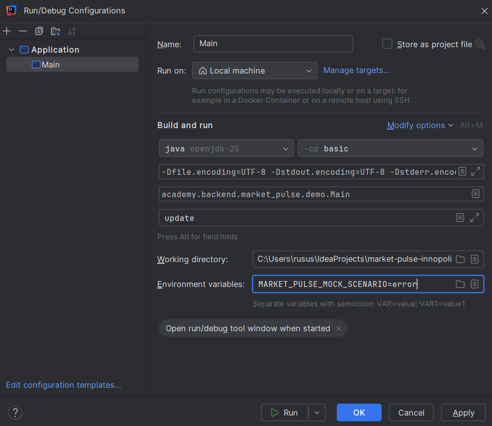

# 01. Market Pulse

Семинар курса «Т-Академия», запуск «Т-Академия 2026», трек «Java Basic».

Исходный код проекта, разрабатываемого в рамках **базового** трека курса по Java.

#### Notice!

> **Данный репозиторий предназначен только для внутреннего использования и не подлежит публикации во вне.**


# Семинар 7: запуск HTTP-клиентов

Клиент переключал в `basic/src/main/java/academy/backend/market_pulse/config/AppConfig.java`,
заменяя строку создания `apiClient`.

Для HttpClient:
```java
this.apiClient = new HttpClientTInvestApiClient(properties);
```

Для Feign:
```java
this.apiClient = new FeignTInvestApiClientReference(properties);
```

Для OkHttp:
```java
this.apiClient = new OkHttpTInvestApiClientReference(properties);
```

Для каждого клиента выполнил три запуска с аргументом `update`:
без переменной `MARKET_PULSE_MOCK_SCENARIO`, со значением `error`
и со значением `timeout`.

В watchlist добавлен SBER.

| Клиент | Без сценария | error | timeout                                                                                                                                      |
|---|---|---|----------------------------------------------------------------------------------------------------------------------------------------------|
| HttpClient | HTTP 200. Обновлена 1 котировка. | Не удалось получить данные от instruments-service: instruments-service вернул неожиданный статус: 500 | Не удалось получить данные от instruments-service: Не удалось выполнить запрос к instruments-service                                         |
| Feign | Обновлено котировок: 1 -> data\quotes.txt | Не удалось получить данные от instruments-service: instruments-service вернул ошибку: 500 | Не удалось получить данные от instruments-service: Не удалось выполнить запрос к instruments-service Через ≈28 секунд получил ошибку запроса |
| OkHttp | Обновлено котировок: 1 -> data\quotes.txt | Не удалось получить данные от instruments-service: instruments-service вернул неожиданный статус: 500 | Не удалось получить данные от instruments-service: Не удалось выполнить запрос к instruments-service. Через ≈7 секунд получил ошибку запроса |


<details>
<summary>Лог HttpClient —  без сценария</summary>

```text
окт. 27, 2026 6:57:23 PM academy.backend.market_pulse.client.impl.HttpClientTInvestApiClient fetchQuotes
INFO: -> GET http://localhost:1080/v1/instruments
окт. 27, 2026 6:57:23 PM academy.backend.market_pulse.client.impl.HttpClientTInvestApiClient fetchQuotes
INFO: <- GET http://localhost:1080/v1/instruments: статус 200, тело 803 байт
Обновлено котировок: 1 -> data\quotes.txt
```

</details>
<details>
<summary>Лог HttpClient —  error</summary>

```text
окт. 27, 2026 6:56:44 PM academy.backend.market_pulse.client.impl.HttpClientTInvestApiClient fetchQuotes
INFO: -> GET http://localhost:1080/v1/instruments
окт. 27, 2026 6:56:44 PM academy.backend.market_pulse.client.impl.HttpClientTInvestApiClient fetchQuotes
INFO: <- GET http://localhost:1080/v1/instruments: статус 500, тело 45 байт
Не удалось получить данные от instruments-service: instruments-service вернул неожиданный статус: 500
```

</details>

<details>
<summary>Лог HttpClient — timeout</summary>

```text
18:54:34 INFO: -> GET http://localhost:1080/v1/instruments
18:54:39 WARNING: ошибка соединения — request timed out
Не удалось получить данные от instruments-service: Не удалось выполнить запрос к instruments-service
```

</details>

// Пример запуска: 

