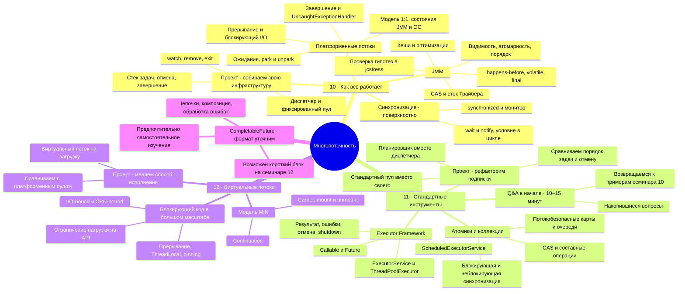

# Многопоточность: карта семинаров 10–12

Продвинутый трек. Один пример — временные подписки на котировки — развивается вместе с темами.

Линия практики: **пишем свой пул → заменяем стандартными исполнителями → выполняем загрузки
на виртуальных потоках**. Пользовательский сценарий сохраняется: оформить подписку на время,
получать результаты в фоне, отменить одну подписку или остановить сервис.

Детальный состав и тайминг семинаров 11–12 ещё предстоит уточнить.
