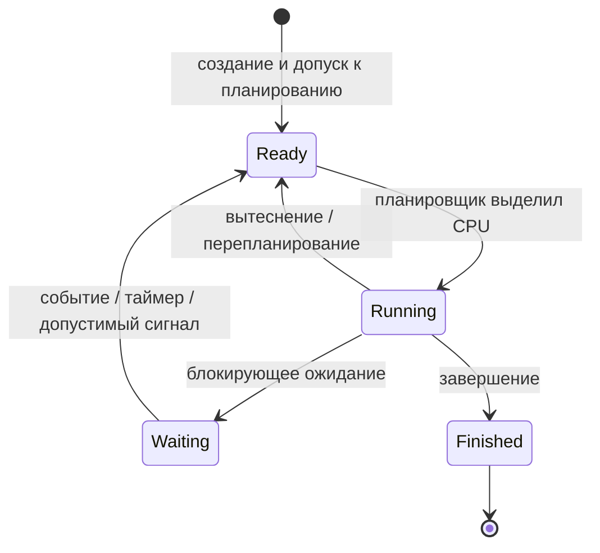
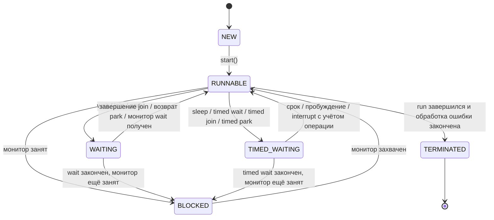

# Потоки ОС, жизненный цикл Java-потока и JMM

Материал для подготовки продвинутого семинара 10. Проверено по Java SE 25 и указанным ниже источникам 1 ноября 2026 года. Диаграммы в Mermaid можно использовать как основу иллюстраций. Это пояснения семинаристу, не предложение перенести весь текст на слайды.

## 1. Состояния потока в ОС

### 1.1. Учебная модель

У разных ОС разные названия и детализация. Для объяснения планирования удобно выделить **готовность**, **исполнение** и **ожидание события**. Это концептуальная схема, не перечень значений конкретного API.



| Состояние | Может ли исполняться на CPU? | Что позволяет продолжить |
|---|---|---|
| Ready | Готов к исполнению, но сейчас CPU ему не выделен | Выбор планировщиком |
| Running | Да: выполняются инструкции в user mode или kernel mode | Сам выполняется, пока не вытеснен, не заблокирован или не завершился |
| Waiting / Sleeping | Пока действительно спит — нет | Событие ожидания, таймер, иногда сигнал |
| Stopped | Не исполняется до возобновления | Команда/сигнал продолжения, действие отладчика |
| Finished | Прикладного выполнения больше нет | Не возобновляется |

**Формулировка для слайда:** готовый поток ждёт процессор; спящий — событие; исполняющийся — расходует процессорное время. Пробуждение обычно означает переход к готовности, а не немедленное исполнение.

### 1.2. Как это выглядит в Linux

В Linux планируемая сущность — task; отдельные потоки процесса тоже имеют task и TID. В `/proc/<pid>/task/<tid>/stat` можно видеть состояние конкретного потока.

| Код | Смысл |
|---|---|
| `R` | Running / runnable: выполняется **или готов**; Ready и Running здесь не разделены |
| `S` | Прерываемое ожидание — interruptible sleep |
| `D` | Непрерываемое ожидание — uninterruptible sleep, часто связанное с I/O |
| `T` | Остановка сигналом |
| `t` | Остановка трассировкой/отладчиком |
| `Z` | Zombie: завершение с ещё не собранной информацией; не обычное состояние каждого завершившегося Java-потока |
| `X` | Dead, обычно кратковременно |
| `I` | Idle kernel thread; для обычного Java worker не целевое состояние |

`R` в `ps` ещё не доказывает, что поток прямо сейчас получает CPU. Измерять нужно дельту CPU time за интервал. [Linux: proc_pid_stat](https://man7.org/linux/man-pages/man5/proc_pid_stat.5.html).

### 1.3. Что значит «ожидает прерывания от ОС»

Полезно разделить три разных понятия:

- **Аппаратное прерывание:** например, устройство сообщает ядру о завершении операции. Обработчик может привести к пробуждению ожидающей task.
- **Сигнал ОС:** отдельный механизм уведомления процесса/потока. Возможность прервать сон зависит от вида ожидания и сигнала.
- **`Thread.interrupt()`:** Java-протокол отмены. Это не команда отправить аппаратное прерывание и не гарантия конкретного POSIX-сигнала.

Поток не обязан ждать именно аппаратного прерывания: его может разбудить другой поток, освобождение ресурса или таймер. Kernel API различают обычное, interruptible и killable ожидание; точные условия зависят от конкретного примитива. [Linux: completion wait APIs](https://docs.kernel.org/scheduler/completion.html).

Не говорить «любой ожидающий поток можно разбудить interrupt». Например, Java-прерывание входа в `synchronized` не отменяет этот вход. [Thread.interrupt](https://docs.oracle.com/en/java/javase/25/docs/api/java.base/java/lang/Thread.html#interrupt()).

## 2. Жизненный цикл Java-потока

### 2.1. Шесть состояний JVM

Далее речь о **платформенных** потоках. Их связь с native threads обычно 1:1. Виртуальные потоки здесь не рассматриваем.

| `Thread.State` | Значение |
|---|---|
| `NEW` | Объект Thread создан, start ещё не выполнен |
| `RUNNABLE` | Исполнение или готовность; возможны и некоторые native-ожидания |
| `BLOCKED` | Ожидание входа в монитор `synchronized`, включая повторный вход после wait |
| `WAITING` | Ожидание без срока: wait, join, park |
| `TIMED_WAITING` | Ожидание с положительным сроком: sleep, timed wait/join/park |
| `TERMINATED` | Исполнение потока завершено |

Ready и Running — полезная детализация планирования **внутри объяснения RUNNABLE**, не дополнительные значения enum. Состояния JVM не являются состояниями ОС. [Thread.State](https://docs.oracle.com/en/java/javase/25/docs/api/java.base/java/lang/Thread.State.html).

### 2.2. Основные переходы



Стрелки показывают причины и возможные наблюдения, а не обещают, что `getState()` успеет увидеть каждый промежуточный шаг. Если монитор после wait сразу доступен, отдельный длительный BLOCKED может не наблюдаться.

### 2.3. Что исправить в приложенной картинке

1. **Стрелки `thread terminated` из WAITING/TIMED_WAITING в TERMINATED неоднозначны и для join неверны.** Если `A` выполняет `B.join()`, завершение **B** позволяет **A** продолжить исполнение. A от этого не завершается.
2. Нет обычного API «убить поток, пока он BLOCKED». Нормальное завершение требует выхода из исполняемого кода; ожидание входа в монитор не отменяется interrupt.
3. Для timed wait тоже нужен повторный захват монитора после таймаута, уведомления или прерывания.
4. `notify` относится к wait set своего объекта. Он не пробуждает произвольный sleep/park/join на другом объекте.
5. Добавить `unpark`, interrupt и ложные пробуждения в причины возврата из park/wait.
6. `yield` — подсказка планировщику, не гарантированный переход с отдачей CPU другому потоку.
7. Не использовать надпись «suspended» как отсылку к устаревшему Thread.suspend: вытеснение планировщиком — другое явление.

Семантика sleep/yield/start/join и прерывания: [Thread](https://docs.oracle.com/en/java/javase/25/docs/api/java.base/java/lang/Thread.html).

### 2.4. `wait` и повторный захват монитора

Вызвавший wait поток должен владеть монитором. Он освобождает **этот** монитор, но не остальные удерживаемые мониторы. После уведомления, таймаута, ложного пробуждения или interrupt ему нужно снова его захватить; только затем wait возвращает управление либо бросает InterruptedException. Notify не освобождает монитор уведомляющего потока и не гарантирует, кто получит его следующим.

```java
synchronized (monitor) {
    while (!ready) {
        monitor.wait();
    }
    consumeResult();
}
```

Цикл нужен и из-за ложных пробуждений, и потому, что после уведомления условие могло снова измениться. Таймаут wait ограничивает фазу ожидания, но не гарантирует возврат метода к точному дедлайну: захват монитора может задержаться. [Object.wait / notify](https://docs.oracle.com/en/java/javase/25/docs/api/java.base/java/lang/Object.html).

### 2.5. `park` — другой механизм

У потока есть не более одного permit. Unpark делает его доступным; park потребляет доступный permit либо ожидает. Unpark до park уже запущенного потока может предотвратить засыпание. Разрешения не суммируются.

Park может вернуться от interrupt, ложного пробуждения, unpark, а timed-вариант — от срока. Он не бросает InterruptedException и не очищает флаг. Возврат не доказывает выполнение прикладного условия. Нужна повторная проверка, обычно через volatile/atomic. Park, в отличие от wait, не освобождает удерживаемые мониторы. [LockSupport](https://docs.oracle.com/en/java/javase/25/docs/api/java.base/java/util/concurrent/locks/LockSupport.html).

### 2.6. Исключение и завершение

Если Throwable выходит из run без обработки, происходит раскрутка стека: выполняются finally и освобождаются мониторы при выходе из synchronized. Затем выполняется uncaught exception handler; после его окончания поток завершается. Handler не возобновляет выполнение с места ошибки. Индивидуальная настройка имеет приоритет; без неё действует ThreadGroup, который может делегировать default handler. Ошибка самого handler игнорируется JVM. [UncaughtExceptionHandler](https://docs.oracle.com/en/java/javase/25/docs/api/java.base/java/lang/Thread.UncaughtExceptionHandler.html).

Start и join не перебрасывают ошибку работника вызывающему потоку. Interrupt сам по себе также не переводит поток в TERMINATED. [Thread](https://docs.oracle.com/en/java/javase/25/docs/api/java.base/java/lang/Thread.html).

## 3. Соответствие JVM и ОС. Ресурсы BLOCKED

### 3.1. Приблизительное соответствие

Это диагностическая ориентировка для HotSpot/Linux, **не переносимая таблица эквивалентности**.

| JVM | Что возможно на уровне ОС |
|---|---|
| NEW | Исполняемого native-потока ещё нет |
| RUNNABLE | Running или Ready; native I/O может при этом усыпить task |
| BLOCKED | Попытки захвата/активное ожидание либо сон native-потока |
| WAITING / TIMED_WAITING | Обычно сон; переход к пробуждению требует работы планировщика |
| TERMINATED | Поток ОС уже завершён или заканчивает служебное освобождение ресурсов; Java-объект может оставаться в heap |

**Вывод:** WAITING/BLOCKED — причины на уровне Java; Running/Sleeping — состояние планирования ОС. Это две оси, а не два словаря с взаимно однозначным переводом. Основание: [Thread.State](https://docs.oracle.com/en/java/javase/25/docs/api/java.base/java/lang/Thread.State.html), [Thread: platform threads](https://docs.oracle.com/en/java/javase/25/docs/api/java.base/java/lang/Thread.html).

### 3.2. Расходует ли BLOCKED процессор?

**При длительной парковке — не занимает CPU постоянно. Но нулевая стоимость и отсутствие любых затрат из BLOCKED не следуют.**

HotSpot при конкуренции за монитор может сочетать попытки захвата, spinning и парковку. Spinning выполняет инструкции и расходует CPU; припаркованный native-поток не крутит цикл проверки. В реализации JDK 25 эти пути видны в `ObjectMonitor`: попытки входа, spin и park. Длительность и выбранный путь — детали реализации, не контракт Java. [HotSpot ObjectMonitor, JDK 25](https://raw.githubusercontent.com/openjdk/jdk/jdk-25-ga/src/hotspot/share/runtime/objectMonitor.cpp).

Помимо памяти существуют затраты на постановку в ожидание, пробуждение и переключения контекста. После пробуждения поток может проиграть захват и заснуть снова. Механизмы вроде Linux futex позволяют держать быстрый путь в user space, а при необходимости передать ожидание ядру. [Linux futex](https://man7.org/linux/man-pages/man2/futex.2.html).

**Фраза для слайда:** «Припаркованный поток не занимает ядро; конкуренция за монитор всё равно имеет стоимость». По одному Thread.State нельзя измерить CPU. Для проверки сопоставляем Java stack, native TID, дельту CPU time и переключения контекста. Не путать с прикладным busy-loop: он обычно остаётся RUNNABLE и может занимать ядро целиком.

## 4. JMM: от предпосылок к прикладным гарантиям

### 4.1. Краткая выжимка из статьи на Хабре

[«Глубокое погружение в Java Memory Model»](https://habr.com/ru/articles/685518/) удобно использовать как линию рассказа:

- исходный порядок строк не определяет, как другой поток наблюдает обращения к памяти;
- оптимизации компилятора и CPU, локальные уровни памяти осложняют межпоточное взаимодействие;
- опыт «записать своё поле, прочитать чужое» допускает два нуля без синхронизации;
- формальные отношения program order, synchronization order и happens-before позволяют объяснить гарантии;
- volatile меняет допустимые исходы и позволяет публиковать предшествующие записи;
- наблюдения нужно проверять concurrency-тестами, сохраняя различие эксперимента и гарантии.

Это краткий пересказ, не копия статьи. Дальше — самостоятельные пояснения с опорой на спецификацию и первичные материалы авторов JMM. Аппаратные аналогии используем осторожно: отдельные кеши не означают полностью независимую память без coherence, а volatile не означает отключение кеширования.

### 4.2. Зачем понадобилась модель памяти


Компилятор может переиспользовать прочитанное значение, убрать лишнее чтение или переставить независимые действия. Процессор тоже исполняет и делает видимыми обращения с учётом своей архитектуры. Сохраняется однопоточная семантика, но доступ к общим данным требует отдельного протокола. JMM позволяет писать переносимую программу, не выбирая вручную инструкции под каждый CPU. [JSR-133 FAQ: reordering и memory model](https://www.cs.umd.edu/~pugh/java/memoryModel/jsr-133-faq.html).

Cache coherence упорядочивает взаимодействие с отдельными адресами, но не заменяет межпеременные гарантии языка. Аппаратная модель и JVM совместно реализуют языковой контракт. Нельзя вывести корректность Java-кода только из утверждения «на x86 сильная память». [JSR-133 Cookbook](https://gee.cs.oswego.edu/dl/jmm/cookbook.html). Cookbook исторический: его старые таблицы инструкций не используем как описание актуальных CPU.

### 4.3. Три вопроса, которые нельзя смешивать

| Свойство | Вопрос | Пример ошибки |
|---|---|---|
| Атомарность | Является ли действие неделимым? | Два `counter++` теряют обновление |
| Видимость | Какие записи доступны чтению? | Флаг готовности не публикует результат |
| Порядок | Какие отношения между действиями гарантированы? | Читатель видит готовность без ожидаемых данных |

Неатомарность составного инкремента остаётся и при volatile: чтение, вычисление и запись — разные шаги. Для атомарного increment существует, например, AtomicInteger; для инварианта из нескольких действий часто нужен общий lock. [Atomic package](https://docs.oracle.com/en/java/javase/25/docs/api/java.base/java/util/concurrent/atomic/package-summary.html).

### 4.4. Что именно задаёт JMM

JMM определяет допустимые выполнения, включая то, какую запись может наблюдать чтение. Это не описание размещения heap/stack и не обещание конкретного порядка машинных инструкций.

**Data race:** конфликтующие обращения к одной переменной, хотя бы одно — запись, не упорядочены happens-before. Более широкое понятие race condition включает и логические гонки: отдельные синхронизированные действия могут быть безопасны сами по себе, но их композиция нарушает инвариант.

Для корректно синхронизированных программ действует SC-for-DRF: о поведении можно рассуждать как о последовательном чередовании действий потоков с сохранением порядка каждого потока. Это не гарантирует бизнес-корректность алгоритма. [JLS 17.4](https://docs.oracle.com/javase/specs/jls/se25/html/jls-17.html#jls-17.4).

### 4.5. Happens-before как инструмент доказательства

| Основание | Ребро HB |
|---|---|
| Program order | Действия одного потока в порядке программы |
| Монитор | unlock → последующий lock **того же** монитора |
| Volatile | запись → последующее чтение **того же** volatile-поля |
| Start | start → действия запущенного потока |
| Завершение | действия потока → успешное ожидание его завершения через join |
| Транзитивность | A → B и B → C дают A → C |

«Последующее» здесь определяется моделью, а не сравнением логов по настенным часам. Успешный возврат timed join по таймауту не равен обнаружению завершения. [JLS 17.4.5](https://docs.oracle.com/javase/specs/jls/se25/html/jls-17.html#jls-17.4.5).

### 4.6. Публикация через volatile-флаг

```java
int result;
volatile boolean ready;

// Writer                  // Reader, одно чтение флага
result = 42;               // if (ready) {
ready = true;              //     use(result); // 42
                           // }
```

Для одноразовой публикации без следующих перезаписей цепочка:

```text
result = 42
    → program order → ready = true
    → synchronizes-with → чтение ready == true
    → program order → чтение result
```

Обычные данные тоже публикуются. Но последующие записи writer после публикации флага этой цепочкой не покрываются. Замена флага обычным boolean убирает гарантию; цикл чтения может не закончиться. Sleep и onSpinWait не исправляют публикацию. [JSR-133 FAQ: volatile](https://www.cs.umd.edu/~pugh/java/memoryModel/jsr-133-faq.html).

### 4.7. Почему опыт с двумя полями даёт (0, 0)

```java
// Изначально x = y = 0
// Actor 1                 // Actor 2
x = 1;                     // y = 1;
r1 = y;                    // r2 = x;
```

Без синхронизации допустимы `(0,0)`, `(0,1)`, `(1,0)`, `(1,1)`. Если представить только последовательные чередования этих четырёх действий, `(0,0)` не получить; это и есть ловушка интуиции. Наблюдение не доказывает конкретную физическую перестановку инструкций: возможна задержка видимости записей. Если **оба** поля volatile, `(0,0)` запрещён. [JMM Pragmatics: SC, synchronization order и примеры](https://shipilev.net/blog/2014/jmm-pragmatics/).

Удобное доказательство: два нуля требовали бы, чтобы каждое чтение предшествовало чужой записи, хотя собственная запись предшествует чтению. Получился бы цикл в общем порядке volatile-действий.

### 4.8. Атомарность отдельных доступов

Чтение/запись ссылки не превращает чтение/изменение объекта в транзакцию. Для обычных long/double спецификация допускает неатомарный доступ; volatile long/double атомарны. Не переносить наблюдаемое поведение конкретной 64-битной JVM на контракт языка. Эти тонкости не нужны для первого опыта с int, но полезны как ответ на вопрос группы. [JMM Pragmatics: access atomicity](https://shipilev.net/blog/2014/jmm-pragmatics/).

### 4.9. Final и безопасная публикация

Final-поля имеют специальные гарантии корректной инициализации при соблюдении правил конструирования. Не выпускать this из конструктора: другой поток не должен увидеть недостроенный объект. Final-ссылка не делает весь достижимый изменяемый граф навсегда неизменяемым и не гарантирует, что plain-ссылка на объект вообще будет своевременно замечена читателем.

Безопасная публикация через volatile-ссылку или общий монитор — более удобный прикладной протокол. Неизменяемость помогает сохранить опубликованное состояние, но не заменяет все способы передачи объекта между потоками. [Safe Publication and Safe Initialization](https://shipilev.net/blog/2014/safe-public-construction/).

### 4.10. Применение в Market Pulse

Наш разбор кода: один writer собирает `MarketSnapshot` локально; после полной сборки делает `current = next`, где current — volatile. Reader один раз сохраняет current в локальную переменную и использует эту версию целиком. Версия, время и цены поэтому относятся к одному снимку. Повторное чтение current для каждого поля могло бы смешать разные версии.

В `MarketSnapshot` карта копируется; значения BigDecimal неизменяемы. Map.copyOf не дала бы глубокой неизменяемости для произвольных mutable values. Ошибка новой загрузки сохраняет предыдущий снимок. Это рассуждение о собственном коде, а не дополнительная гарантия volatile «на все действия программы».

### 4.11. Что даёт jcstress

Actors выполняют конкурентные действия; outcomes заранее классифицируют результаты. Подготовленные эксперименты семинара:

| Опыт | Ключевой вопрос |
|---|---|
| DekkerPlain / Volatile | Возможны ли два нуля? |
| PublicationPlain / Volatile | Можно ли увидеть готовность без данных? |
| IncrementPlain / Volatile | Теряется ли инкремент? |
| FinalPublication | Какие значения допустимы у final-поля? |

Редкий разрешённый исход можно не встретить. Много успешных запусков не доказывает корректность; запрещённый исход требует проверки теста, допущений и реализации. JMH решает другую задачу — измерение производительности. [OpenJDK jcstress](https://github.com/openjdk/jcstress).

## 5. Что вынести на слайды

1. ОС: Ready / Running / Waiting и таблица «кто занимает CPU».
2. JVM: шесть состояний, отдельно пояснение Ready/Running внутри RUNNABLE.
3. Переходы wait → повторный захват; join пробуждает ожидающего, когда завершается целевой поток.
4. BLOCKED: парковка не занимает ядро, spinning и пробуждения имеют цену.
5. Предпосылки JMM → опыт с двумя полями → HB → публикация.
6. Volatile не делает ++ атомарным; final не делает mutable-объект immutable.
7. Финал: обосновать согласованный снимок одной цепочкой публикации.

Полные ссылки даны у соответствующих объяснений. Статью на Хабре использовать как педагогический референс, спецификацию — как основание гарантий. Не перегружать занятие causality/out-of-thin-air и таблицами барьеров CPU: это отдельное углубление.
